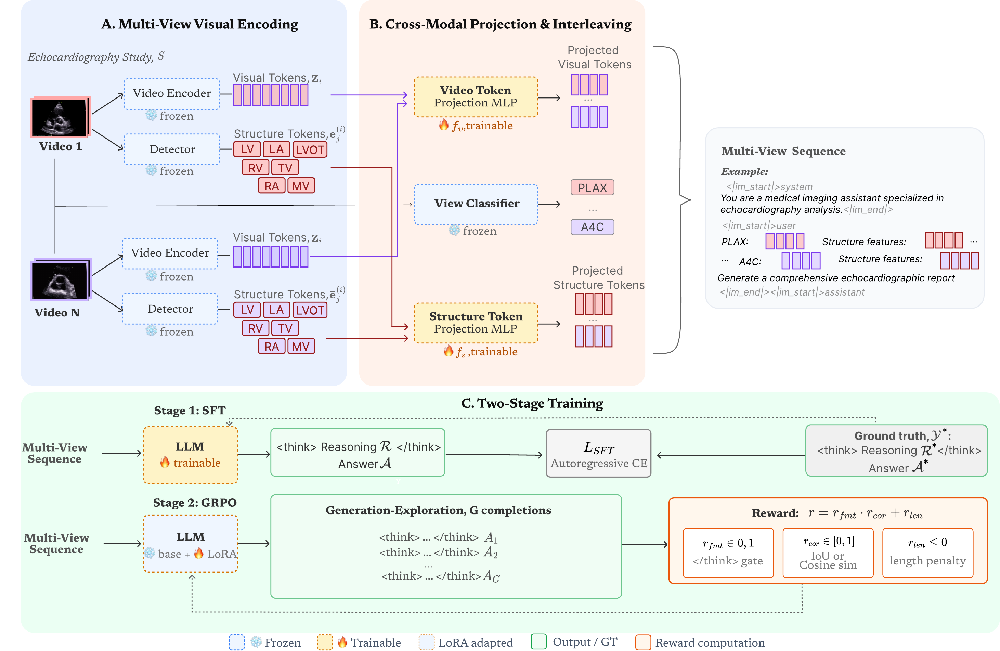

# EchoSonar

**EchoSonar-R: A Multi-View Reasoning-Enabled Model for Disease Classification and Report Generation in Echocardiography**

Darya Taratynova, Ahmed Aly, Numan Saeed, Mohammad Yaqub

[[Paper]](https://arxiv.org/abs/2606.28164) [[HuggingFace]](https://huggingface.co/daryataratynova8/echosonar)



EchoSonar turns a folder of echo videos into structured features — and,
with the released checkpoint, a written report — for downstream models.

## To start

```bash
pip install -r requirements.txt
```

Grab the EchoPrime weights from <https://github.com/echonet/EchoPrime>
(`model_data/weights/`, you only need `echo_prime_encoder.pt` and
`view_classifier.pt` from it — using them means agreeing to EchoPrime's
academic licence). Put the folder wherever you like; you'll point
`--weights-dir` at it.

You'll also need `MIL_weights.csv` from that same EchoPrime checkout
(`EchoPrime/assets/MIL_weights.csv`). It's auto-detected next to `--weights-dir`, or
pass `--mil-weights /path/to/MIL_weights.csv` if it lives somewhere else.

Arrange your study as one folder per study, one subfolder of PNG frames per
clip:

```
my_study/
├── clip_001/         # frames: 0.png, 1.png, ...
├── clip_002/
└── clip_003/
```

Then run:

```bash
python scripts/extract_echoprime_embeddings.py \
    --study my_study/ \
    --weights-dir /path/to/model_data/weights \
    --out-dir outputs/
```

which gives you `outputs/clip_embeddings.h5` and `outputs/study_embeddings.h5`
— a 512-d vector per clip, and the whole study aggregated into one embedding
per report section. Peek at either with:

```bash
python examples/inspect_h5.py outputs/study_embeddings.h5
```

In case you have many studies, give each its own subfolder under one root and add
`--root /data/echo_studies --multi`

## Structure detection

A second, independent feature file — bounding boxes and embeddings for 7
cardiac structures (LV, LA, RA, RV, mitral valve, tricuspid valve, LVOT),
over the same clips and frames as above. Needs the RT-DETR checkpoint,
downloaded from [daryataratynova8/echosonar](https://huggingface.co/daryataratynova8/echosonar)
on HuggingFace (same repo as the report checkpoint below):

```bash
huggingface-cli download daryataratynova8/echosonar \
    rtdetr_cardiac_7cls.pt view_classifier.pt --local-dir checkpoints/
```

```bash
python scripts/extract_detections.py \
    --study my_study/ \
    --checkpoint checkpoints/rtdetr_cardiac_7cls.pt \
    --out-dir outputs/
```

Gives you `outputs/detections.h5`. Same `--root --multi` / `--manifest`
flags as the embeddings script apply here too.

## Report generation

Grab the trained EchoSonar checkpoint (projectors + fine-tuned LLM) from the
same HuggingFace repo:

```bash
huggingface-cli download daryataratynova8/echosonar \
    --include "sft/*" --local-dir checkpoints/
```

which lands at `checkpoints/sft/` (`clip_projector.pt`, `detr_projector.pt`,
`llm/`) — that's what you point `--checkpoint` at below. This step also
needs `checkpoints/view_classifier.pt` from the command above.

```bash
python scripts/extract_echoprime_tokens.py \
    --study my_study/ --weights-dir /path/to/model_data/weights --out-dir outputs/

python scripts/generate_report.py \
    --study my_study/ \
    --clip-tokens outputs/clip_tokens.h5 \
    --detections outputs/detections.h5 \
    --checkpoint checkpoints/sft \
    --config config.yaml
```

## GRPO checkpoint
```bash
huggingface-cli download daryataratynova8/echosonar \
    --include "grpo/*" --local-dir checkpoints/
```

You need `checkpoints/sft/llm` downloaded too (previous
section) before you can load it. Use `config.grpo.yaml` instead of
`config.yaml`, which points `model_name` at that local SFT checkpoint
instead of the base Qwen3-8B:

```bash
python scripts/generate_report.py \
    --study my_study/ \
    --clip-tokens outputs/clip_tokens.h5 \
    --detections outputs/detections.h5 \
    --checkpoint checkpoints/grpo \
    --config config.grpo.yaml
```

## Citation

If you find this work useful, please cite:

```bibtex
@misc{taratynova2026echosonarr,
      title={EchoSonar-R: A Multi-View Reasoning-Enabled Model for Disease Classification and Report Generation in Echocardiography},
      author={Darya Taratynova and Ahmed Aly and Numan Saeed and Mohammad Yaqub},
      year={2026},
      eprint={2606.28164},
      archivePrefix={arXiv},
      primaryClass={cs.CV},
      url={https://arxiv.org/abs/2606.28164},
}
```
